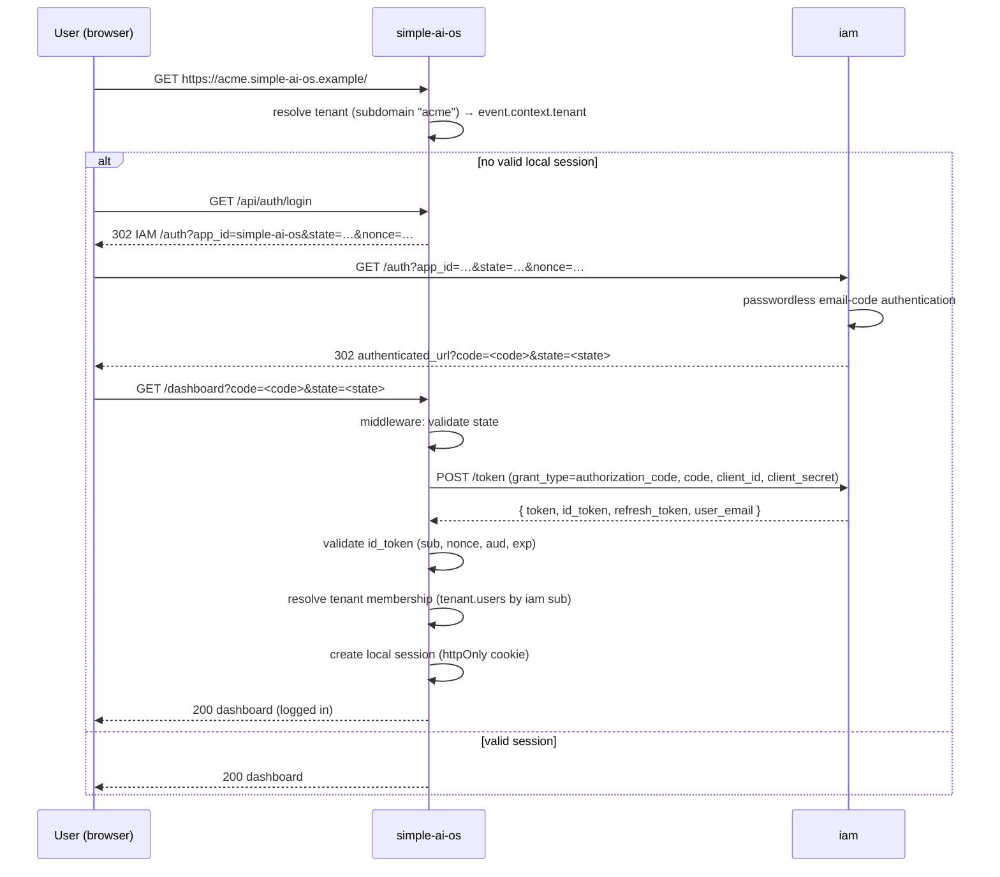

# 07 — Target Architecture (Multitenancy + IAM SSO)

> **ADM phases.** Phase B, C (Data + Application), D — Target ("to-be") descriptions,
> followed by Phase E/F gap analysis and an incremental work-package roadmap.
> **Companion.** This document is the *target* half of the Architecture Definition
> Document; the *baseline* ("as-is") is described in `01`–`06`. Read `06` §6 (the
> consolidated baseline gap register) first — most gaps it lists are resolved by this
> target.
>
> **Scope of change.** Two capabilities, both already proven elsewhere in the
> `tryyourideas` workspace and adopted here rather than reinvented:
>
> 1. **Multitenancy** — isolate `simple-ai-os` data per customer, following the
>    schema-per-tenant pattern already used by `web/home`.
> 2. **SSO with `iam`** — delegate authentication to the centralized `web/iam` service,
>    consuming the shared `lib/nuxt-iam-client` module already extracted for that purpose.

---

## 1. Target architecture vision (Phase A)

`simple-ai-os` evolves from a single-tenant tutorial app into a **multi-tenant AI
operating surface** whose identity is delegated to the central `iam` service:

```
                          ┌──────────────────────────────┐
                          │            iam               │
                          │  (web/iam — identity only)   │
                          │  GET /auth, POST /token,     │
                          │  passwordless email codes,   │
                          │  apps/clients registry       │
                          └──────────────┬───────────────┘
                                         │  authorization-code redirect (browser)
                                         │  + token exchange (backend → backend)
                          ┌──────────────▼───────────────┐
                          │   simple-ai-os (this app)    │
                          │  nuxt-iam-client (SSO client)│
                          │  tenant middleware (subdomain)│
                          │  chat · prompts · MCP        │
                          └──────────────┬───────────────┘
                                         │  schema-per-tenant
                          ┌──────────────▼───────────────┐
                          │  PostgreSQL 18                │
                          │  public.tenants (registry)    │
                          │  tenant_<slug>.* (isolated)   │
                          │  sessions (DB-backed)         │
                          └──────────────────────────────┘
```

The two additions are orthogonal and compose cleanly: **iam decides *who* you are**
(identity), **the tenant layer decides *which data* you may see** (isolation), and
**`simple-ai-os` decides *what you may do*** (authorization), the same split already
adopted by `web/home`'s admin (`iam` proves identity, `home` enforces `ADMIN_EMAIL`).

### 1.1 Target drivers

| # | Driver | Change vs. baseline |
|---|--------|---------------------|
| D1–D6 | (unchanged from `01` §2) | retained |
| D7 | SSO readiness | **promoted**: from requirement-only (`docs/authentication.md`) to implemented via `nuxt-iam-client` |
| D8 | **Multitenancy** (new) | isolate prompts, history, and conversations per customer; tenant onboarding without code changes |
| D9 | **Data isolation & tenancy governance** (new) | per-tenant schemas, tenant-scoped DB access, per-tenant migration bookkeeping |

### 1.2 Target principles (additions to `01` §4)

| # | Principle | Rationale |
|---|-----------|-----------|
| P9 | **Tenant isolation by construction** | data lives in per-tenant schemas, so a query can never leak across tenants unless it explicitly names another schema |
| P10 | **Delegated identity, local authorization** | `iam` proves identity; `simple-ai-os` owns roles/membership and never duplicates the primary login |
| P11 | **Reuse over rebuild** | adopt `web/home`'s tenant pattern and `lib/nuxt-iam-client` rather than re-implementing them |
| P12 | **Schema-validated, tenant-scoped interfaces** | every API/MCP request is bound to a resolved tenant context (`event.context.tenant`) before touching data |

---

## 2. Target business architecture (Phase B)

### 2.1 Target actor catalog (additions to `02` §2.1)

| # | Actor | Description | New/changed |
|---|-------|-------------|-------------|
| A5 | IAM (identity provider) | authenticates users, issues one-time authorization codes + tokens | **now wired** (was "future") |
| A6 | Tenant member (user) | an authenticated user who belongs to a tenant and uses its chat/prompts | new |
| A7 | Tenant admin/owner | a tenant member with the right to manage that tenant's prompts/users | new |
| A8 | Platform operator | provisions tenants and registers the `simple-ai-os` app in `iam` | new |

### 2.2 Target role catalog (additions to `02` §2.2)

| # | Role | Scope | Enforcement |
|---|------|-------|-------------|
| R5 | IAM-authenticated user | global identity (has a valid `iam` session + `simple-ai-os` session) | `nuxt-iam-client` `useAuth()` |
| R6 | Tenant member | `users` row in the tenant schema; `role: member` | tenant-scoped guard |
| R7 | Tenant admin | `users` row with `role: admin` in the tenant schema | tenant-scoped guard (mirrors `home`'s `requireAdminSession`) |
| R8 | Unauthenticated visitor | may view the landing page; redirected to `iam` for anything tenant-scoped | SSO middleware |

### 2.3 Target capability catalog (additions to `02` §2.3)

| # | Capability | Description | Owner (target component) |
|---|-----------|-------------|---------------------------|
| F13 | SSO login / logout | authorization-code flow against `iam`; local session + refresh | `nuxt-iam-client` routes/middleware, `useAuth()` |
| F14 | Tenant resolution | derive tenant from `Host` subdomain, load tenant context | `server/middleware/tenant.ts` (new) |
| F15 | Tenant-aware data access | all prompt/chat queries run against the resolved tenant's schema | `server/db/client.ts` (getTenantDb), `server/db/tenant.ts` (new) |
| F16 | Tenant provisioning | create tenant row + schema + run tenant migrations + seed admin | `server/db/scripts/provision-tenant.ts` (new) |
| F17 | Tenant-scoped MCP | MCP prompt exposure restricted to the caller's tenant + auth | `server/mcp/*` (hardened) |
| F18 | Tenant membership/roles | map `iam` subject → tenant user/role; gate admin actions | `server/utils/tenantAccess.ts` (new) |

### 2.4 Target processes (key flows)

#### BP8 — SSO login (authorization-code)

```text
User  ──GET https://acme.simple-ai-os.example/──► simple-ai-os
        (no valid session)                             │
                                                 GET /api/auth/login
                                                       │ state+nonce persisted,
                                                       │ redirect
                                                       ▼
                 iam  GET /auth?app_id=simple-ai-os&state=…&nonce=…
                       │ passwordless email-code authentication
                       ▼
                 iam  ──302→ authenticated_url?code=<code>&state=<state>──► browser
                                                       │
                                                 simple-ai-os middleware
                                                       │ 1. validate state
                                                       │ 2. POST /token (client_id/secret, code)
                                                       │ 3. validate id_token (sub/nonce/aud/exp)
                                                       │ 4. resolve tenant (subdomain) + membership
                                                       │ 5. create local session (httpOnly cookie)
                                                       ▼
                                            render authenticated page
```

#### BP9 — Tenant provisioning

```text
Operator ── npm run db:provision-tenant -- --slug acme --name "Acme Co" --owner-email owner@…
  │  1. insert public.tenants (slug, schema_name = tenant_acme)
  │  2. CREATE SCHEMA tenant_acme
  │  3. run tenant Drizzle migrations (migrationsSchema = tenant_acme)
  │  4. seed tenant users (owner, approved)
  ▼
Tenant live at acme.simple-ai-os.example
```

### 2.5 Target business interaction matrix (additions)

| Function | A5 IAM | A6 Member | A7 Tenant admin | A8 Operator |
|----------|:--:|:--:|:--:|:--:|
| F13 SSO | ● | ● | ● | |
| F14 Tenant resolution | | ● | ● | |
| F15 Tenant-aware data | | ● | ● | |
| F16 Provisioning | | | | ● |
| F17 Tenant MCP | | ● | ● | |
| F18 Membership/roles | | | ● | |

---

## 3. Target data architecture (Phase C — Data)

### 3.1 Tenancy model: schema-per-tenant

**Decision** (see `ADR/0004`): one Postgres **public** schema holds the tenant
registry; each tenant gets its own Postgres **schema** (`tenant_<slug>`) with its own
copy of the application tables. This is the same model `web/home` already runs in
production, so the tooling, `getTenantDb` pool pattern, and `migrationsSchema`
bookkeeping are proven.

| Model | Isolation | Ops | Consistency with workspace | Verdict |
|-------|-----------|-----|---------------------------|---------|
| Shared schema + `tenant_id` column | weak (every query needs a filter) | simplest | none | rejected |
| **Schema-per-tenant** | strong (separate namespace) | medium | **matches `home`** | **chosen** |
| Database-per-tenant | strongest | heavy (per-tenant DB/creds) | none | deferred |

### 3.2 Target logical data model

**Public schema (registry)** — new table:

| Entity | Key fields | Notes |
|--------|-----------|-------|
| `tenants` | `id` (uuid pk), `slug` (unique), `schema_name` (unique), `company_name`, `created_at` | mirrors `home`'s `public.tenants` |

**Tenant schema** (`tenant_<slug>`) — existing tables, plus new:

| Entity | Key fields | Change vs. baseline |
|--------|-----------|---------------------|
| `prompts` | (unchanged fields) | now tenant-scoped by schema |
| `prompt_history` | (unchanged fields) | now tenant-scoped by schema |
| `users` | `id` (uuid pk), `iam_sub` (unique), `email`, `role` (`member`/`admin`), `approved_at` | **new** — maps an `iam` identity to a tenant role (mirrors `home`'s `users`) |
| `threads` | `id` (uuid pk), `user_id` fk→`users`, `title`, `created_at` | **new** — replaces the `session` fs namespace |
| `messages` | `id`, `thread_id` fk→`threads`, `role`, `content`, `created_at` | **new** — replaces `{ messages, claudeResponse }` fs blobs |

### 3.3 Session & conversation storage — resolve the split-brain

| Baseline | Target |
|----------|--------|
| `unstorage` fs `session` namespace (chat history) | DB `threads` + `messages` (tenant schema) |
| `unstorage` fs `assets:sessions` (stub `userId: '123'`, `role: 'admin'`) | **deleted**; identity comes from the `iam` session via `nuxt-iam-client` |
| `session_id` httpOnly cookie (unauthenticated stub) | `iam_session` httpOnly cookie + server-side session store |
| `nuxt-iam-client` in-memory `iam:sessions` | mounted to a persistent driver (Redis or DB) for production — see `lib/nuxt-iam-client` "Session storage" |

### 3.4 Target application / data matrix

| Entity / store | Chat | Prompts | MCP | Improve | Auth |
|----------------|:--:|:--:|:--:|:--:|:--:|
| `public.tenants` | R (resolve) | R (resolve) | R (resolve) | R (resolve) | |
| `tenant.prompts` | R | R/W | R | R | |
| `tenant.prompt_history` | | R/W | | | |
| `tenant.users` | | | | | R (membership) |
| `tenant.threads`/`messages` | R/W | | | | |
| `iam` (external) | | | | | R/W (auth/token) |

### 3.5 Target data lifecycle & retention

| Entity | Lifecycle | Retention |
|--------|-----------|-----------|
| `tenants` | created at provisioning; removed only by platform operator | permanent |
| `prompts` / `prompt_history` | per-tenant CRUD + snapshots (unchanged ADR-0001 semantics) | still unbounded → **define per-tenant retention** (closes gap G9) |
| `threads` / `messages` | per-user conversations | delete on tenant teardown; optional TTL per tenant |
| `iam` session store | issued by `nuxt-iam-client`; refresh-token rotation | expires per `iam` token config |

### 3.6 Target data security

| Concern | Target control |
|---------|----------------|
| Tenant isolation | per-tenant schema + `search_path` fixed per connection pool (`getTenantDb`) |
| Cross-tenant leak | impossible without an explicit schema-qualified query; tenant middleware rejects unknown/missing tenants (`404`) |
| Identity | `iam` session; `iam` tokens never logged, never exposed to the browser |
| Roles | `tenant.users.role`; admin actions gated (mirrors `home`'s `requireAdminSession`) |
| Secrets | `NUXT_IAM_CLIENT_SECRET`, DB creds via `.env` (gitignored); client secret never in browser |

---

## 4. Target application architecture (Phase C — Application)

### 4.1 Target application portfolio (additions to `04` §4.1)

| # | Module | Type | Purpose | Source (target) |
|---|--------|------|---------|-----------------|
| AP13 | SSO client | Nuxt module (shared) | login/logout/session + callback middleware + `useAuth()` | `lib/nuxt-iam-client` |
| AP14 | Tenant middleware | Nitro middleware | resolve `event.context.tenant` from `Host` | `server/middleware/tenant.ts` |
| AP15 | Tenant data access | internal module | cached per-schema Drizzle clients, `withTenantDb()` | `server/db/client.ts` |
| AP16 | Tenant guard | Nitro middleware/util | enforce tenant membership + role | `server/utils/tenantAccess.ts` |
| AP17 | Provisioning script | CLI | create tenant + schema + migrations + seed owner | `server/db/scripts/provision-tenant.ts` |
| AP18 | Tenant-aware MCP | internal module | MCP prompts scoped to tenant + auth | `server/mcp/server.ts` |

### 4.2 Target interface catalog (changes to `04` §4.2)

| Method | Endpoint | Auth (target) | Purpose |
|--------|----------|---------------|---------|
| GET | `/api/auth/login` | public | redirect to `iam` `/auth` (from `nuxt-iam-client`) |
| GET | `/api/auth/session` | cookie | current session user |
| POST | `/api/auth/logout` | cookie | destroy local session |
| POST | `/api/agent`, `/api/agent-stream` | **required** | chat, tenant + user bound |
| GET/POST/… | `/api/prompts/**` | **required** | prompts, tenant-scoped |
| POST | `/mcp` | **required (bearer)** | MCP prompts, tenant-scoped |
| GET | `/api/new-thread`, `/api/login` | **removed** | superseded by `nuxt-iam-client` + DB threads |

> `GET /api/login` (the stub `initSession` with hardcoded `userId: '123'`) and the
> `assets:sessions` namespace are **deleted** in the target.

### 4.3 Target application interaction (SSO + tenant) diagram

```
 Browser ──► [tenant middleware: resolve subdomain → tenant ctx] ──► page/route
                  │
                  ├── (no session) GET /api/auth/login ──► iam GET /auth
                  │
                  └── (?code=&state=) nuxt-iam-client middleware
                          │  state/nonce check
                          │  POST /token (client_id/secret, code) ──► iam
                          │  validate id_token (sub/aud/exp/nonce)
                          │  createIamSession() → iam_session cookie
                          ▼
                  tenant guard (tenant.users membership + role)
                          │
                          ▼
                  withTenantDb(schema) ──► prompts / threads / messages
```

### 4.4 SSO sequence (mermaid)



### 4.5 MCP under multitenancy

The baseline MCP server is stateless and unauthenticated. Target:

- MCP requests carry an `Authorization: Bearer <iam access token>` (or a derived
  `simple-ai-os` API token).
- The server resolves the tenant (subdomain or explicit header) and reads prompts only
  from that tenant's schema, preserving the existing stateless "fresh server per request"
  design (ADR-0005 in `04`).

> **Flag:** `iam` Phase 1 issues **HS256** (symmetric, shared `IAM_JWT_SECRET`) tokens and
> exposes **no JWKS/introspection endpoint** yet, and `nuxt-iam-client` decodes the
> `id_token` without verifying its signature. Until `iam` adds RS256/JWKS and
> introspection, MCP must not rely on JWT signature verification alone. See `ADR/0005`
> consequences.

---

## 5. Target technology architecture (Phase D)

### 5.1 Target technology standards (additions to `05` §5.1)

| # | Standard / product | Purpose | Source (reference) |
|---|--------------------|---------|--------------------|
| T16 | `lib/nuxt-iam-client` | SSO client Nuxt module | `web/lib/nuxt-iam-client` |
| T17 | `iam` (web/iam) | identity provider | `web/iam` |
| T18 | Drizzle Kit | migrations per schema (public + tenant) | `home`'s `drizzle.config.*.ts`, `provision-tenant.ts` |
| T19 | Redis (or DB) | persistent `iam:sessions` + session store | replaces in-memory default |

### 5.2 Target platform decomposition

```
Node.js process (Nuxt/Nitro "simple-ai-os")
├── Frontend (Vue 3)
│   └── pages/ (index, dashboard, chat, chat-streaming, prompts/*, not-authenticated)
├── Nitro server
│   ├── middleware/tenant.ts          (tenant resolution)
│   ├── utils/tenantAccess.ts         (membership + role guard)
│   ├── db/client.ts                  (public + cached per-schema tenant clients)
│   ├── db/schema/public.ts, tenant.ts
│   ├── db/scripts/provision-tenant.ts
│   ├── api/ (agent, agent-stream, prompts/*, auth/* via nuxt-iam-client)
│   ├── mcp/ (tenant-scoped, bearer-auth)
│   └── lib/ (agent, agent-streaming, prompts, threads/messages)
├── modules: nuxt-iam-client (routePrefix/composableAlias as needed)
└── External dependencies
    ├── PostgreSQL 18  (public schema + tenant_<slug> schemas)
    ├── iam            (identity)
    └── Anthropic API  (Claude)
```

### 5.3 Target deployment & environments

| Environment | App | DB | IAM | Notes |
|-------------|-----|-----|-----|-------|
| Local dev | `http://localhost:3000` | Postgres (public + tenant schemas) | local `iam` | `.env` with `NUXT_IAM_*` |
| Docker (dev/prod) | container | `postgres` service + `migrate` on boot | reachable `iam` | add `iam`/`redis` services to compose |
| Production | `*.simple-ai-os.example` (subdomain per tenant) | managed Postgres, per-tenant schemas | managed `iam` | TLS, reverse proxy, session persistence |

### 5.4 Target software distribution

- Drizzle Kit migrations checked in under `server/db/migrations/{public,tenant}/`, applied
  by a boot plugin and the provisioning script (mirrors `home`'s `server/plugins/migrate.ts`
  + `provision-tenant.ts`).
- `iam` app registration (obtaining `app_id`/`client_secret`) is a one-time manual step per
  environment via `iam`'s `/admin` dashboard (per `iam`'s current contract).

---

## 6. Gap analysis (baseline → target)

> Resolves most of the baseline register in `06` §6.

| # | Baseline gap (`06` §6) | Target change | Work package |
|---|-------------------------|---------------|--------------|
| G2 | No authentication | `nuxt-iam-client` + `iam` app registration; delete stub `login`/`session.ts` | WP-2 (SSO) |
| G3 | No migrations (init.sql only) | Drizzle Kit per-schema migrations + boot plugin + provisioning | WP-1 (tenant scaffolding) |
| G4 | Session split-brain | DB-backed `threads`/`messages`; delete `assets:sessions` | WP-3 (data) |
| G5 | Hardcoded model/prompts | (unchanged scope) — retain as separate tech-debt item | — |
| G9 | No retention | per-tenant retention policy for `prompt_history`/`threads` | WP-4 |
| G10 | No backup/DR | per-tenant schema backup strategy | WP-4 |
| — | Single-tenant data | schema-per-tenant + tenant middleware + tenant-scoped queries | WP-1 |
| — | Unauthenticated MCP | bearer auth + tenant scoping | WP-5 |

### 6.1 Work packages (recommended order)

| WP | Name | Depends on | Notes |
|----|------|-----------|-------|
| WP-1 | Tenant scaffolding (registry, schema-per-tenant, `getTenantDb`, `provision-tenant.ts`, migrations) | — | copy/adapt `home` pattern |
| WP-2 | SSO integration (`nuxt-iam-client`, app registration, delete stub session, login/logout UI) | — | independent of WP-1 |
| WP-3 | Data model (DB `threads`/`messages`, `users`, tenant-scope prompts) | WP-1 | resolves split-brain |
| WP-4 | Retention + backup + session persistence (Redis/DB) | WP-3 | closes G9/G10 |
| WP-5 | Tenant-scoped, bearer-authenticated MCP | WP-1, WP-2 | depends on `iam` JWKS/RS256 for strong verification |

---

## 7. Open decisions (to confirm with stakeholders)

1. **One `simple-ai-os` app_id vs. per-tenant app_id in `iam`** — `iam`'s model is
   *client = tenant, tenant registers applications*. If each tenant must own its `iam`
   registration, then `NUXT_IAM_APP_ID` becomes tenant-derived; otherwise a single shared
   app registration suffices and the tenant is resolved purely by subdomain. **Recommend
   the single-app model first**, tenant derived from subdomain.
2. **`iam` token asymmetry** — Phase 1 uses HS256 + no JWKS/introspection; confirm when
   `iam` will expose RS256/JWKS + introspection so `simple-ai-os` (and `nuxt-iam-client`)
   can verify signatures rather than decode.
3. **Session store backend** — Redis vs. DB for `iam:sessions` in production.
4. **MCP auth mechanism** — bearer `iam` access token vs. a `simple-ai-os`-issued token.

---

## 8. Definition of done (target)

- [ ] `tenants` registry + schema-per-tenant data isolation in place (WP-1).
- [ ] `iam` SSO works end-to-end against a running `iam` (WP-2), verified by Playwright.
- [ ] All tenant-scoped endpoints and MCP reject missing/foreign tenants (no data leak).
- [ ] `iam` tokens are never logged and never reach the browser; only the local session does.
- [ ] Migrations are reproducible via Drizzle Kit per schema (WP-1).
- [ ] Decisions recorded as ADRs (`ADR/0004`, `ADR/0005`).

Supporting decisions: [`ADR/0004-multitenancy-schema-per-tenant.md`](./ADR/0004-multitenancy-schema-per-tenant.md),
[`ADR/0005-sso-via-nuxt-iam-client.md`](./ADR/0005-sso-via-nuxt-iam-client.md).
