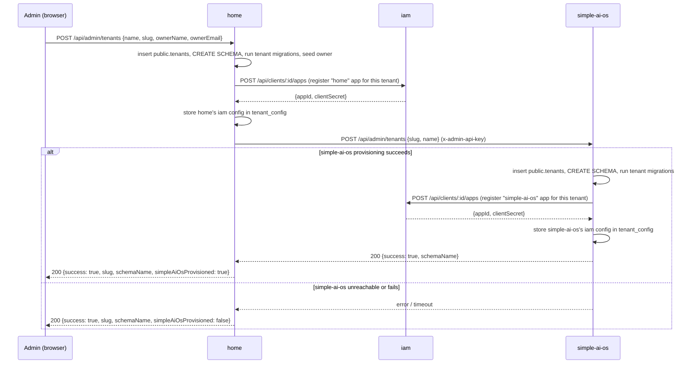

# Design: cross-app tenant auto-provisioning (home → simple-ai-os), phase 2

## Context

Phase 1 (`docs/superpowers/specs/2026-08-19-multitenancy-sso-design.md`, implemented) gave
`simple-ai-os` its own schema-per-tenant multitenancy and `iam` SSO, with each tenant owning
its own `iam` app registration (`applicationName: 'simple-ai-os'`), mirroring how `web/home`
already registers its own `applicationName: 'home'` app per tenant. Provisioning a
`simple-ai-os` tenant today requires a separate manual step
(`npm run db:provision-tenant -- --slug ... --name ...`) after a tenant is created in `home`.

This phase makes that automatic: creating a tenant in `home`'s admin also provisions the
matching `simple-ai-os` tenant, with no second manual step. It also confirms (from phase 1's
research into `iam`'s `/auth` route) that "already logged into home → auto-logged into
simple-ai-os" requires no additional code — `iam` reuses its existing browser session across
any app that redirects a user to it.

This is a two-repo change: `web/home` (the caller) and `web/simple-ai-os` (the callee).

## Decisions

1. **Call semantics: synchronous, non-fatal on failure.** `home`'s tenant provisioning
   endpoint (`server/api/admin/tenants/index.post.ts`) calls into `simple-ai-os` inline, in
   the same place and the same way it already calls `iam` to register the `home` app for that
   tenant. If the call fails, `home`'s own tenant (already committed: registry row, schema,
   migrations, owner user, `home` iam app) is **not** rolled back — the response reports the
   partial failure instead, exactly matching the existing pattern for the `iam`-registration
   step (`502` with "provisioned but iam app registration failed — retry is safe").

2. **Auth: shared static API key, not OAuth/mTLS.** This is a backend-to-backend call between
   two trusted services in the same operator-controlled workspace, not a user-facing surface.
   Reuse `iam`'s existing `requireAdminApiKey` pattern verbatim (`x-admin-api-key` header,
   SHA-256 + `timingSafeEqual` comparison — see `iam/server/utils/hash.ts` and
   `iam/server/utils/adminApiAuth.ts`) rather than inventing a new scheme. New env vars:
   `NUXT_SIMPLE_AI_OS_URL` and `NUXT_SIMPLE_AI_OS_ADMIN_API_KEY` in `home`;
   `NUXT_ADMIN_API_KEY` in `simple-ai-os` (same secret value on both sides).

3. **`simple-ai-os` gets a reusable provisioning function, not duplicated logic.** Extract the
   body of `server/db/scripts/provision-tenant.ts` into `server/lib/provisionTenant.ts`
   (`provisionTenant({ slug, name }): Promise<{ schemaName: string; alreadyExisted: boolean }>`),
   called by both the CLI script and the new HTTP endpoint. (`home` currently duplicates this
   logic between its own script and endpoint — not repeating that mistake here.)

4. **Idempotency, so retries are safe.** `provisionTenant()` first checks `public.tenants` for
   an existing row with that slug. If found, it's a no-op that returns the existing
   `schemaName` (`alreadyExisted: true`) instead of throwing a unique-violation — this is what
   makes both a `home`-side retry and the backfill script (decision 6) safe to run repeatedly.

5. **New endpoint: `POST /api/admin/tenants` in `simple-ai-os`.** Body `{ slug, name }`, gated
   by `requireAdminApiKey`, calls `provisionTenant()`. Returns `{ success: true, slug,
   schemaName, alreadyExisted }`.

6. **Retry mechanism: a backfill script, not a UI.** `home` gets
   `server/db/scripts/backfill-simple-ai-os-tenant.ts`, a direct port of the existing
   `backfill-tenant-iam.ts` shape: loop every `home` tenant, call the new `simple-ai-os`
   endpoint, skip/log per tenant, never abort the whole run on one failure. No admin UI change
   in `home` — this mirrors the existing tooling-only retry story for the analogous
   `iam`-registration gap.

## Data flow

## Error handling

- `simple-ai-os` endpoint auth failure (missing/wrong `x-admin-api-key`): `401`, matching
  `iam`'s `requireAdminApiKey`.
- `simple-ai-os` endpoint called for an already-provisioned slug: `200`, `alreadyExisted: true`
  — not an error, since this is what makes retries and the backfill script safe.
- `home`'s call to `simple-ai-os` failing (network error, non-2xx, timeout): caught, logged,
  does not fail `home`'s own request — `simpleAiOsProvisioned: false` in the response, fixable
  later via the backfill script.

## Testing

- `simple-ai-os`: unit test for `provisionTenant()`'s idempotency (calling it twice returns
  `alreadyExisted: true` the second time, no throw); unit test for the new
  `requireAdminApiKey`-equivalent auth guard (missing key → 401, wrong key → 401, correct key →
  passes).
- `home`: unit test for the new provisioning step's non-fatal failure handling (mock the
  `simple-ai-os` call to reject, assert the tenant is still returned as created with
  `simpleAiOsProvisioned: false`); unit test for the backfill script's skip-on-already-done and
  continue-on-error behavior (mirroring `backfill-tenant-iam.ts`'s existing test coverage, if
  any — port the same shape if none exists yet).

## Out of scope

- Any `home` admin UI surfacing `simple-ai-os` provisioning status (backfill script is the
  retry mechanism).
- Changes to the "already logged into home → auto-logged into simple-ai-os" SSO behavior —
  already works via `iam`'s existing cross-app session reuse, confirmed in phase 1.
- WP-3/4/5 from `simple-ai-os`'s own target architecture (still tracked in
  `simple-ai-os/docs/backlog.md`).
