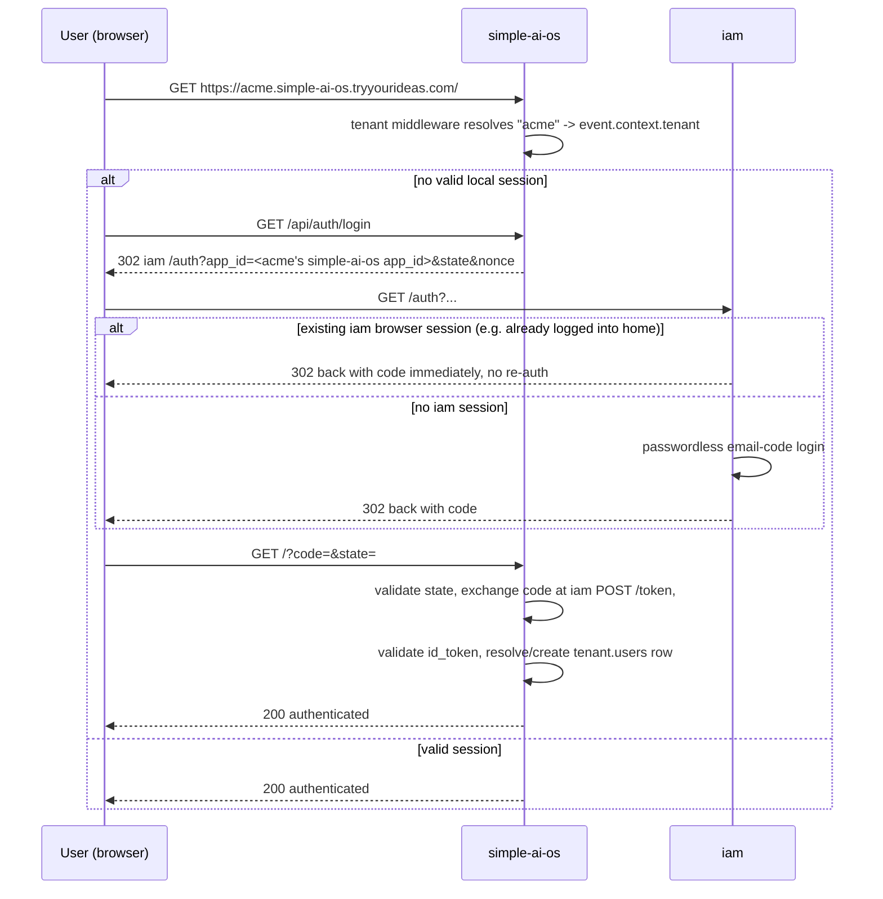

# Design: simple-ai-os multitenancy + iam SSO (Phase 1 of 2)

## Context

`simple-ai-os` is a single-tenant tutorial app with no real authentication (`server/lib/session.ts`
mints a stub `{ userId: '123', role: 'admin' }` session). The workspace already has:

- `web/home`, which runs schema-per-tenant Postgres in production (`public.tenants` registry +
  `tenant_<slug>` schemas) and already SSOs its `/admin` login through `iam`.
- `lib/nuxt-iam-client`, the shared Nuxt module extracted specifically so other apps (like this
  one) can adopt `iam` SSO without re-implementing the authorization-code handshake.
- `simple-ai-os/docs/architecture/07-target-architecture.md`, `ADR/0004`, and `ADR/0005`, which
  already specify the target shape of this work as work packages WP-1 (tenant scaffolding) through
  WP-5 (tenant-scoped MCP).

This spec scopes **Phase 1**: WP-1 (tenant scaffolding) + WP-2 (SSO), the prerequisite for a
**Phase 2** (separate, future spec) where `home`'s tenant-provisioning flow automatically
provisions a matching tenant space in `simple-ai-os` and registers it in `iam`, so a tenant
created in `home` gets a `simple-ai-os` space for free, and a user already logged into `home`
lands in `simple-ai-os` already authenticated (this second part requires no new code beyond
standard SSO — `iam`'s `/auth` route already reuses an existing browser session across apps).

WP-3 (DB-backed `threads`/`messages` replacing the `unstorage` fs session store), WP-4
(retention/backup/persistent session store), and WP-5 (bearer-authenticated tenant-scoped MCP)
are explicitly deferred — confirmed with the user. The fs session store is left as-is; it is not a
cross-tenant leak risk today because `session_id` cookies are host-scoped to each tenant's
subdomain by default.

## Decisions

1. **Tenancy model**: schema-per-tenant Postgres, identical to `home`'s pattern (ADR-0004,
   already accepted). `public.tenants` registry (`id`, `slug`, `schema_name`, `company_name`,
   `created_at`); each tenant gets `tenant_<slug>` with its own `prompts`, `prompt_history`
   (now schema-scoped instead of global), and a new `users` table (`id`, `iam_sub`, `email`,
   `role: member|admin`, `approved_at`).

2. **Tenant resolution**: `server/middleware/tenant.ts`, a direct port of `home`'s
   `server/utils/tenant.ts` — parse the `Host` header's first label as the slug, treat known
   apex hostnames and bare IPv4 addresses as "no tenant" (apex/dev-server), 404 on an unknown
   slug. Sets `event.context.tenant`.

3. **Tenant-scoped DB access**: `server/db/client.ts` gets `getTenantDb(schemaName)` /
   `withTenantDb(schemaName, fn)`, one cached connection pool per schema with `search_path`
   fixed at connection time (`postgres(url, { connection: { search_path: '<schema>,public' } })`)
   — per the `home` learnings doc, `drizzle()` requires the full client object, not a
   `sql.reserve()`'d connection, so per-tenant pools are used instead of per-query `SET
   search_path`.

4. **Provisioning**: `server/db/scripts/provision-tenant.ts`, mirroring `home`'s script —
   insert the registry row, `CREATE SCHEMA IF NOT EXISTS`, run Drizzle migrations with
   `migrationsSchema: schemaName` (per the `home` learnings doc — Drizzle's own migration
   bookkeeping table defaults to a fixed `"drizzle"` schema and silently no-ops on the second
   tenant otherwise), seed nothing else (no owner user yet — that's created on first SSO login,
   see decision 6).

5. **SSO**: mount `lib/nuxt-iam-client` per ADR-0005 — `GET /api/auth/login`,
   code/state/nonce exchange middleware, `GET /api/auth/session`, `POST /api/auth/logout`,
   `useAuth()`. Delete `server/lib/session.ts`, `server/api/login.ts`, and
   `server/api/new-thread.ts`'s `assets:sessions` stub.

6. **Per-tenant `iam` app registration** (resolves target-doc open decision #1 in favor of what
   `home` actually implements, not what the doc speculated): each tenant gets its own `iam`
   `app_id`/`client_secret`, obtained via the same `registerTenantIamApp`-shaped call `home`
   uses and stored the same way (`tenant_config` row, key `iam_integration`, keyed by
   `applicationName: 'simple-ai-os'`) — this is what lets Phase 2 add a `simple-ai-os` entry
   next to `home`'s existing entry with no schema change. Registration happens at
   provisioning time in this phase (manual/CLI), not yet triggered by `home`.

7. **Tenant membership on first login**: `nuxt-iam-client`'s post-auth hook resolves
   `event.context.tenant`, looks up `tenant.users` by `iam_sub`; if no row exists, create one
   with `role: 'member'` (mirrors "seed owner" for the first user of a freshly provisioned
   tenant — the tenant owner is the first person who completes SSO login, since Phase 1 has no
   owner-email seeding step). Tenant-admin promotion is manual (direct DB update) for now — no
   admin UI in this phase.

8. **Domain convention**: dev `{slug}.localhost:3000` (matches `home`'s `*.localhost`
   convention, RFC 6761, zero `/etc/hosts` config); production
   `{slug}.simple-ai-os.tryyourideas.com` (matches `home`'s `{slug}.tryyourideas.com`).

9. **Removed endpoints**: `GET /api/login`, `GET /api/new-thread` (superseded by
   `nuxt-iam-client`'s session endpoints).

## Data flow (SSO + tenant, condensed from `07-target-architecture.md` §4.4)

## Error handling

- Unknown tenant subdomain: 404 (matches `home`'s `resolveTenant`).
- `iam` app registration failure during provisioning: provisioning script fails loudly (schema
  and registry row already exist — safe to retry, matching `home`'s idempotent
  `getTenantIamAppConfig` check-before-register).
- Missing/invalid `state`/`nonce`/`id_token` during the SSO callback: handled entirely inside
  `nuxt-iam-client` (out of scope here — already hardened there).

## Testing

- Unit: `server/utils/tenant.test.ts` (slug extraction, apex/IP handling — port `home`'s
  existing test cases), `server/db/client.test.ts` (pool caching by schema).
- Vitest e2e-api: provision a test tenant (`test/helpers/db.ts`-style `ensureTestDatabase`),
  hit a tenant-scoped endpoint with and without a valid session, assert 401/200 and schema
  isolation (two tenants, two prompts with the same name, no collision).
- Playwright: full SSO login redirect against a running local `iam`, mirroring `home`'s
  `e2e/login.spec.ts` pattern (`*.localhost` navigation, not header spoofing — `fetch`/browser
  both refuse to let client code set `Host`).

## Out of scope (Phase 2, separate future spec)

- `home`'s tenant-provisioning endpoint calling simple-ai-os to auto-create the matching tenant
  + register its `iam` app when a `home` tenant is created.
- Any UI in `home`'s admin surfacing simple-ai-os tenant status.
