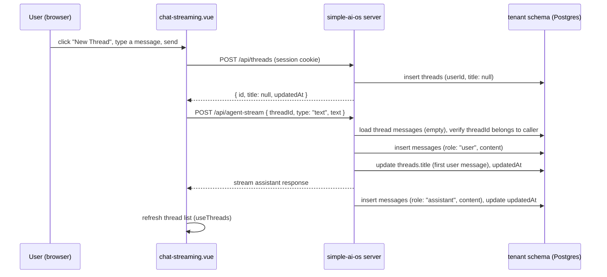
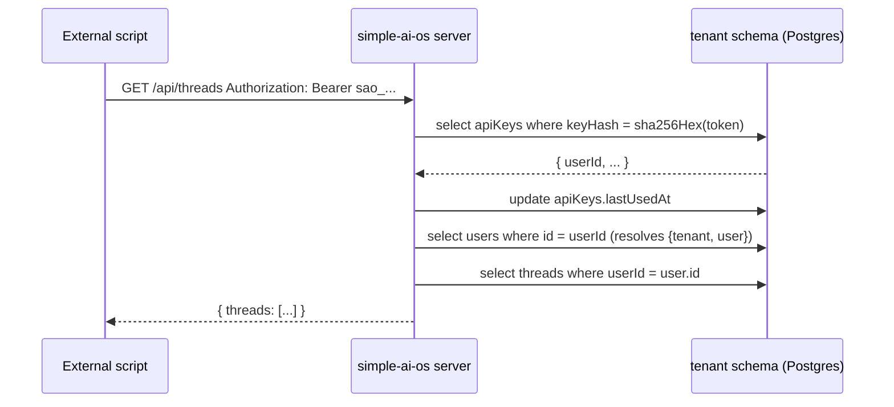

# Design: DB-backed conversation threads + per-user API keys (WP-3)

## Context

`simple-ai-os` currently keeps chat history in `unstorage`'s `session` fs namespace, keyed by a
`session_id` cookie — not tied to the authenticated tenant user, invisible after a page refresh
(the frontend never reads it back), and the one remaining part of the app that isn't inside the
tenant's Postgres schema despite phase 1 making everything else schema-isolated. This is
`docs/backlog.md`'s WP-3 item.

While designing this, a related gap surfaced: today, `/api/prompts/**`, `/api/agent`, and
`/api/agent-stream` are only reachable with a browser session cookie (`requireTenantSession`).
There's no way for an external script or integration to call them. This spec adds that alongside
the thread persistence, since the new `threads`/`messages` endpoints would otherwise be the only
ones *without* that option.

## Decisions

1. **Data model**: two new tenant-schema tables.
   - `threads`: `id` (uuid pk), `userId` (fk → `users.id`), `title` (nullable text), `createdAt`,
     `updatedAt`.
   - `messages`: `id` (uuid pk), `threadId` (fk → `threads.id`), `role` (`'user'|'assistant'`),
     `content` (text), `createdAt`.
   - Content is always stored as plain text. This also fixes a small existing inconsistency:
     `server/lib/agent.ts` currently pushes raw Anthropic content blocks into its in-memory
     history while `server/lib/agent-streaming.ts` pushes a plain string — both normalize to
     plain-text `content` going forward, since that's what both DB storage and UI rendering need.
   - The `claudeResponse` array kept in today's fs blob is **not** persisted — it's write-only in
     the current code (never read back for anything).

2. **Thread creation is explicit, not lazy-on-first-message, for the streaming/switcher page**:
   `chat-streaming.vue` always resolves an active thread (creating one via `POST /api/threads` if
   none is selected) *before* calling `/api/agent-stream`. This avoids the problem of returning a
   newly-created thread id through a streaming response body — thread creation happens as an
   ordinary JSON POST, not extracted from a stream.

3. **`chat.vue` (no switcher UI) stays lazy and invisible to the user**: `POST /api/agent`
   internally gets-or-creates the caller's most-recently-updated thread — no `threadId` in the
   request/response at all. Its "New Thread" button calls `POST /api/threads` (making the new
   thread the most-recent one) and clears local UI state; no other frontend change.

4. **API surface**:
   - `GET /api/threads` — the caller's threads, newest-`updatedAt`-first.
   - `POST /api/threads` — create an empty thread (`title: null` until the first message).
   - `GET /api/threads/:id/messages` — full history for one thread; 404 if it isn't the caller's.
   - `POST /api/agent-stream` now requires `threadId` in the body (decision 2); `POST /api/agent`
     takes none (decision 3).
   - `GET /api/new-thread` is removed — `POST /api/threads` replaces it.
   - Title is set from the first *user* message (truncated) the first time one is appended to a
     thread whose `title` is still `null` — no separate rename UI.

5. **Frontend**: `chat-streaming.vue` gets a left sidebar (thread title + relative last-updated
   time, click to switch — switching calls `GET /api/threads/:id/messages` and replaces the
   visible conversation). A new `app/composables/useThreads.ts` holds the list/switch/create logic
   so it isn't duplicated ad hoc inside the page component. `chat.vue` gets the DB backend with no
   visible UI change.

6. **Per-user API keys** (personal-access-token model, applies to *every* existing tenant-scoped
   endpoint, not just the new thread ones): a new `apiKeys` table (`id`, `userId` fk, `name`
   nullable, `keyHash` unique, `createdAt`, `lastUsedAt` nullable). Tokens are generated as
   `sao_<32 random bytes, base64url>`, shown once in plaintext at creation, stored only as
   `sha256Hex(token)` (reusing `server/utils/hash.ts` from phase 2) — lookup is a direct indexed
   hash match (same pattern GitHub/Stripe PATs use; a wrong guess simply matches no row, so this
   doesn't need `timingSafeEqual` the way the phase-2 *fixed-secret* admin key comparison does).

7. **Auth guard extended in place, not duplicated**: `server/utils/requireTenantSession.ts` gains
   an `Authorization: Bearer <token>` check *before* falling back to the existing session-cookie
   path, both resolving to the same `{ tenant, user, via: 'session' | 'apiKey' }` shape (the `via`
   discriminator is what lets `POST /api/api-keys` refuse bearer-authenticated calls — decision 8
   below — without a second, parallel auth function). Every current call site (`prompts`, `agent`,
   `agent-stream`) and the new `threads` endpoints get API-key support automatically — the key
   inherits exactly the permissions its owning user already has, since it resolves to that same
   `user` row.

8. **Key management is endpoints-only this round, no UI**: `POST /api/api-keys` (session-cookie
   auth only — you must already be logged in via the browser to mint a key for yourself; returns
   the plaintext token once), `GET /api/api-keys` (list your own keys' id/name/createdAt/
   `lastUsedAt`, never the token or hash), `DELETE /api/api-keys/:id` (revoke). A settings-page UI
   for this is a natural follow-up, tracked separately in `docs/backlog.md` rather than built now.

9. **Cleanup**: remove the `session_id` cookie, the `nitro.storage.session` fs driver in
   `nuxt.config.ts`, and all `useStorage('session')` calls. `data/sessions/` becomes unused (it's
   already gitignored, so no tracked-file cleanup is needed).

## Data flow (chat-streaming.vue, new thread)

## Data flow (API-key-authenticated external call)

## Error handling

- `GET /api/threads/:id/messages` for a thread owned by a different user (even within the same
  tenant): 404, not 403 — matches the existing "prompt not found" convention elsewhere in this
  app, and avoids confirming a thread id exists at all to someone who doesn't own it.
- `POST /api/agent-stream` with a `threadId` that doesn't belong to the caller: 404, same reason.
- An `Authorization: Bearer` header with an unrecognized/revoked token: falls through to the
  session-cookie check (which will also fail if there's no valid session) rather than immediately
  401ing — an expired/wrong bearer token alongside a still-valid session cookie should not break a
  normal browser session.
- `POST /api/api-keys` with an `Authorization: Bearer` header instead of a session cookie: 401 —
  minting a new key must be session-authenticated, not key-authenticated (a leaked key can't be
  used to mint itself replacements). Enforced by checking `via === 'session'` on the resolved
  session (decision 7), not by using a separate/duplicated auth function.

## Testing

- Unit: `server/lib/threads.ts` functions (`getOrCreateLatestThread`, `createThread`,
  `listThreads`, `getThreadMessages`, `appendMessage`'s title-setting-on-first-message behavior),
  mirroring `server/lib/prompts.ts`'s existing DI-on-`db` test style.
- Unit: `requireTenantSession`'s extended bearer-token path (valid token → resolves user, updates
  `lastUsedAt`; invalid/missing token → falls through to session check), extending the existing
  `requireTenantSession.test.ts`.
- Unit: `server/api/api-keys/*` handlers (create returns plaintext once, list never returns
  hash/token, delete only removes the caller's own key not another user's).
- e2e-api (real Postgres, mirroring `test/e2e-api/tenant-isolation.test.ts`'s pattern): create a
  thread, send messages, verify `GET /api/threads/:id/messages` round-trips them, verify a second
  tenant/user cannot read the first's thread even by guessing its id.

## Out of scope

- API key management UI (endpoints only this round — tracked as a follow-up backlog item).
- Thread deletion/archiving UI or endpoint.
- Migrating existing fs `data/sessions/*` history into the new tables (low-stakes teaching-app
  data; cutting over cleanly is simpler and was confirmed acceptable).
- Renaming a thread manually (title is always auto-derived from the first message).
