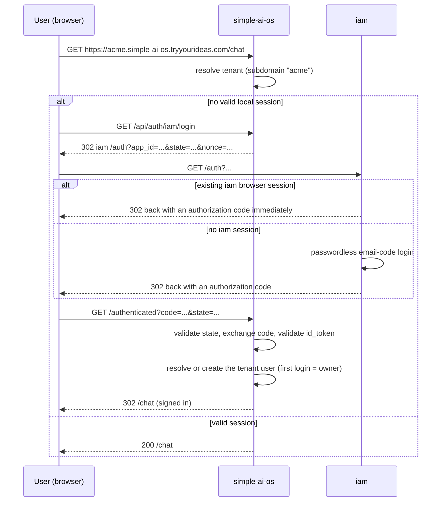
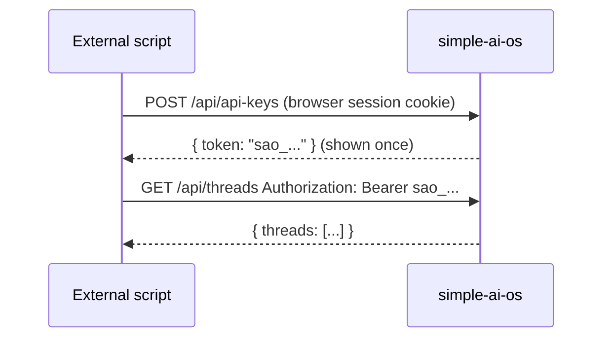

# User Manual

## Getting a tenant space

You don't provision a simple-ai-os tenant directly — it's created automatically when an operator
provisions your company as a tenant in `web/home`'s admin (**Tenants** → **New Tenant**). That
step also registers this tenant's own `iam` login, so as soon as it's done you can sign in per
"Logging in" below. If you already had an account in `home`, you don't need to sign in again here
either — see the next section.

## Logging in

simple-ai-os delegates authentication to `iam`, the workspace's centralized identity service.
There's no local password — you sign in with a passwordless "tryyourideas ID".

1. Visit your tenant's subdomain (e.g. `https://acme.simple-ai-os.tryyourideas.com`) and open
   `/chat`. If you're not signed in, you're redirected to `/login`.
2. Click **Log in with tryyourideas ID**. This redirects you to `iam`.
3. If you already have a valid `iam` session (for example, because you're already logged into
   another tryyourideas app), you're bounced straight back in — no further steps needed.
   Otherwise, `iam` emails you a one-time code to complete a passwordless login.
4. After a successful login, you land on `/authenticated`, which redirects you into `/chat`.

Logging out clears the local session and returns you to the homepage.

## Starting a new conversation

Click **New Thread** in the chat UI to clear the current conversation and start fresh.

## Switching between conversations (`/chat-streaming`)

`/chat-streaming` keeps every past conversation, listed by title (auto-derived from its first
message) in the left sidebar, newest-first.

1. Click **New Thread** to start a fresh, untitled conversation — it appears in the sidebar as
   soon as you send its first message.
2. Click any other entry in the sidebar to switch to it; its full history loads into the chat
   panel.

`/chat` (the non-streaming page) has no sidebar — it always continues your most recently used
conversation, and **New Thread** there starts a new one without showing a list.

## Creating and using a personal API key

For scripts or integrations that need to call the chat/prompts/threads API without a browser:

1. While logged in, call `POST /api/api-keys` (optionally `{ "name": "my script" }`). The
   response includes the plaintext token (`sao_...`) — copy it now, it's never shown again.
2. Send it as `Authorization: Bearer <token>` on any subsequent request instead of relying on
   your browser session cookie.
3. Revoke it any time with `DELETE /api/api-keys/:id` (get the id from `GET /api/api-keys`,
   which never returns the token itself).

